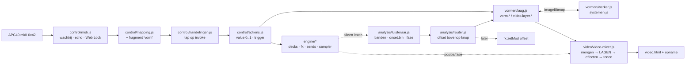

<!-- Synthese van tien agenten, 24 september 2026. Invalshoeken en onderbouwing: 02-analyses.md. Nagerekend: 5/83 blauwdrukfuncties in de kern, sp tot 82 ms, 291 mappingregels, fftSize 1024. -->
# Plan: AV-kern × Varve DJ, samengebracht

> **Besloten op 24 september 2026:**
> - Beslissing 1: Varve stap 1 eerst, daarna AV-kern.
> - Beslissing 3: beeldlagen tussen mengen en effecten.
> - Beslissingen 2 en 4: Clay vroeg "wat denk jij?". Het advies was geen tweede
>   MIDI-driver, en de bron van de vormen in Varve. Clay liet daarop stap 1 bouwen.
> - Beslissing 7: APC-plek zoals geadviseerd. Detail View = mapje "vorm",
>   Device ◀ ▶ = vorm, Bank ◀ ▶ = laag, On/Off = aan/uit, knobs 1–6 + 7 = dekking.
>   De videomodus blijft gelijk.
> - **Stap 1 is gebouwd** (zie HANDOFF). Beslissingen 5, 6 en 8 zijn volgens
>   het advies genomen: aanpassen, 2 lagen, eigen dekking. Nog open: 9–12.

## 1. De kern in 5 zinnen

1. **Het projectplan van 23 september klopt niet meer.** Het ging uit van een Varve DJ die "alleen plan" was. Varve is een werkende app met 8 tracks, streaming, een tempokaart, een videomixer, sends, een sampler en opname. Er zijn 24 testbestanden met 1480 groene checks, en een APC-mapping in 0x42 met 291 regels.
2. **Varve is op alle vlakken beter, dus we bouwen Varve niet opnieuw op AV-kern.** De AV-kern-driver zet de APC in 0x41 en vraagt zelf `requestMIDIAccess` aan, buiten de Web Lock om. Hij stuurt zijn LED's zonder wachtrij, en dat is precies het patroon achter de Chrome-crashes van 22 en 23 september. Van de 83 blauwdrukfuncties herkent de kern er maar 5.
3. **Echt nieuw is maar een klein stuk:**
   - de 26 Vormmachines als beeldlagen;
   - realtime analyse (banden, centroid) met een modulatierouter;
   - een handelingenlog met replay;
   - een handvol DJ-functies uit de blauwdruk: beatjump, starten op de maat, kill, loop in/out, brake.
4. **De aanpak: de ideeën van AV-kern komen als gewone modules in Varve.** Ze komen in `src/vormen/`, `src/analysis/` en `src/control/`, in plain JS, en elke functie begint met `define()`. Er komt geen pluginsysteem en geen TypeScript-pakket. Alleen de Vormmachines en de analysefunctie worden als pure JS gedeeld met AV-kern.
5. **De opdracht "twee los publiceerbare TS-plugins" vervalt grotendeels.** Voor één gebruiker kost dat meer dan het oplevert: een tweede MIDI-laag, een tweede slew-bus en een buildstap. Die zouden gegarandeerd uit elkaar gaan lopen.

## 2. Wat we overnemen, wat niet, en in welke vorm

| Onderdeel | Bron | Vorm in Varve | Waarom | Sessies |
|---|---|---|---|---|
| 26 Vormmachines | `vormmachines.html` r.240–755 | `src/vormen/systemen.js` (plain JS). `Grid()` wordt `OffscreenCanvas`, de tijd `g.t` komt van de host, `rng` en `hud` worden van buiten ingespoten | Echt nieuw. Door die aanpassingen draaien ze in een Worker en volgen ze regel 3 | 1 |
| Laaghaak in de videomixer | projectplan r.90–96 | `addLayer()` in `video-mixer.js` (~50 r), met de rekenregels puur in `src/video/lagen.js` | Opname en beamer krijgen de laag vanzelf mee (zelfde canvas) | 0,75 |
| Adapter en scheduler | projectplan `VormModule` | `src/vormen/laag.js`. Het budget wordt **gemeten in ms per module**, niet geteld in lagen | De kosten per systeem verschillen tot 30× | 0,75 |
| Worker | risico-analyse | `src/vormen/werker.js`, geeft een `ImageBitmap` terug | Nodig voor cl, ln, gs en sp; sp piekt tot 82 ms | 1–1,5 |
| Realtime analyse | `audioAnalyse` r.868 | `src/analysis/features.js` (puur), `luisteraar.js` (leest alleen uit), `hoorbaar.js` | De analysers per strip bestaan al (`audio-graph.js:38`), alleen worden ze niet uitgelezen | 1 |
| Modulatierouter | vormmachines r.874–946 | `src/analysis/router.js`. Een route is een **offset bovenop de knop** en loopt niet via `actions.set` | Anders lopen soft-takeover, de LED-ringen en de basisstand mee | 0,75 |
| Blauwdruk-importeur | Bedienplan, `apc40.ts` | `src/control/blauwdruk.js` plus een dekkingsrapport (kern, alias, stub, ontbreekt) | Werkt als importformaat en als bouwlijst, niet als runtime | 0,75 |
| Handelingenlog en replay | `log.ts` | `src/control/handelingen.js`: `{t: ctx.currentTime, action, v}`, afgetapt op `invoke`. De hash gaat over de reeks actions, niet over de engine | Een hash over de engine-staat is onmogelijk: dat botst met regel 3 en met streaming | 1 |
| DJ-functies | `blueprint-varvedj.json` | `track.N.beatjump.*`, `.play.quant`, `.low/mid/high.kill`, `.loop.in/out`, `.brake` | Nu 0 treffers in `src/` | 1,5–2 |
| **Niet:** kern-driver, `connectApc40`, pick-up, LED-cache | `midi.ts`, `apc40.ts` | – | Varve heeft 0x42, een wachtrij van 16 per 4 ms, een echofilter, de lock en endless-ringen | 0 |
| **Niet:** slew-bus als tussenlaag | `bus.ts` | Alleen als `exp(-dt/τ)` op de audioklok, in de router, voor beeld | rAF staat stil in een achtergrondtab, en 60 Hz geeft trapjes | 0 |
| **Niet:** Python-sidecar, SoundTouch, Vite/TS in Varve, twee-decks-indeling | projectplan | – | Er bestaan al `detect.js`, de keuze voor Signalsmith, de regel "geen build" en de indeling "één kolom = één track" | 0 |

## 3. Doelbeeld

- **Regel 1:** `src/engine/` importeert niets van dit alles. Luisteraar, router, vormen en mixer lezen de engine alleen uit, net als `video-mixer.js` nu. `regels.test.mjs` krijgt er een verbod bij op `requestMIDIAccess` buiten `control/midi.js`.
- **Regel 2:** elke vorm-knop is een `value` van 0..1, en de adapter schaalt naar min..max. Routesterkte (`mod.N.amount`) is ook een value.
- **Regel 3:** `g.t` en `dt` komen van `ctx.currentTime` min de uitgangsvertraging. De tel komt van `klokTrack()`. Het uitsterven van `glad` en `ENV` gaat in seconden, niet per frame. Een vormlaag heeft geen positie. Dat leggen we vast: **"video is slaaf van de positie, beeldlagen zijn slaaf van de maat."**

## 4. Fasering in grote stappen

**Stap 0: besluiten, 0 sessies.** Beslissingen 1–4 hieronder. Daarnaast de APC-regel tussen de apps: AV-kern draait op :5173 en Varve op :8777. Dat zijn verschillende origins, dus ze delen de Web Lock niet. Er is altijd maar één app open met de APC.

**Stap 1: vormen op het scherm en op de APC, 2,5 sessies.**
- **Wat:**
  - de laaghaak met `lagen.js` en tests in `video.test.mjs`;
  - `systemen.js` uitgepakt, met in deze stap alleen de lichte systemen (bd, fl, km, lz, cc, sf, ec);
  - de actions `video.layer.N.*` plus `apc-beschrijf`;
  - een mappingfragment achter `?vormen=1`, samengevoegd in de browser. Clay's eigen regels winnen.
- **Klaar als:** Clay drukt op Detail View en ziet dat de device knobs de vorm draaien, met de ring mee. Device ◀▶ bladert door de vormen. De laag staat op de beamer en in de mp4. Pixel, spiegel en sporen werken er ook op. De puls slaat op de tel. Zonder vlag is het beeld bit voor bit hetzelfde als nu.
- **AV-kern:** krijgt `systemen.js` als pure module en kan die gebruiken in plaats van de sessies 06d–f.

**Stap 2: beeld dat de mix hoort, 2 sessies.**
- **Wat:** `hoorbaar.js` vervangt de drie kopieën. Daarnaast `features.js`, `luisteraar.js` (banden realtime, onset uit `onset.bin` met realtime flux als terugval) en `router.js` met `mod.N.amount`. `metPuls` wordt omgezet naar een route als bewijs dat het werkt.
- **Klaar als:** Clay zet de bass-kill aan op de track die het hardst klinkt, en de vorm zakt zichtbaar in. Bij een fader dicht bij `follow` verdwijnt de laag.
- **AV-kern:** krijgt `features.js` als pure functie.

**Stap 3: zware vormen zonder haperen, 1,5–2 sessies.**
- **Wat:**
  - een Worker met OffscreenCanvas;
  - een scheduler met een EMA per module en kwaliteitsknoppen (cl 70k iteraties, if 60k, gs.sp, ln.R, ph-agents);
  - sp begrensd op een maximum aantal lawinestappen per frame;
  - een benchtest in Node: p99 ≤ 8 ms per stap.
- **Klaar als:** met cl + ln op het scherm en 8 decks geladen knippert de APC nog op de tel, komt een hotcue direct, en springt de video niet. Dat meten we in een Chrome-profiel, in Clay's tabblad.
- **AV-kern:** dezelfde Worker is bruikbaar voor zijn Strata en Deeltjes.

**Stap 4: DJ-functies uit de blauwdruk, 1,5–2 sessies.**
- **Wat:** beatjump (shift + Bank ◀▶), `play.quant` (Activator met shift, nu vrij), kill-toggles, loop in/out en brake. Elk krijgt eerst een `define()`, daarna een regel in `apc40mk2.json`, en daarna wordt Clay's eigen kopie samengevoegd.
- **Klaar als:** Clay hoort een beatjump van 4 tellen die in de maat blijft, en hoort een track die precies op de volgende maat invalt.

**Stap 5: handelingenlog en blauwdruk-import, 1,5 sessies.**
- **Wat:** `handelingen.js` met export, replay en een hashtest in Node. Daarnaast `blauwdruk.js` met een dekkingsrapport op `blueprint-varvedj.json`.
- **Klaar als:** Clay neemt 5 minuten spelen op, speelt het terug en ziet dezelfde knoppen en LED's. Het geluid is vrijwel gelijk, maar niet hash-exact.
- **AV-kern:** zijn blauwdrukken worden leesbaar in Varve.

**Totaal:** ongeveer 9–10 sessies. Dat is een schatting, niet gemeten. Keylock (A3), PFL (F1) en toonsoort blijven op de eigen roadmap van Varve.

## 5. Uitbreidingen die hierdoor mogelijk worden (waarde per moeite)

1. **Beeldscènes, `video.black` en `video.flash`** op grid-rij 1 in de videomodus en op Stop All (81). Veel waarde, 0,5 sessie.
2. **Routes per nummer, bewaard zoals racks:** de "beeldpatch" komt mee met de track. 0,5 sessie.
3. **ec (elementaire CA) als stapsequencerbeeld:** één rij per achtste tel. Vrijwel gratis na stap 2.
4. **Geluidsbestemmingen:** de bas van track 1 duwt het filter van track 2 omlaag, via `fx.zetMod` en de 33 ms-timer, niet via rAF. 0,5 sessie.
5. **Opnieuw renderen uit het handelingenlog:** een set opnieuw draaien met andere visuals. Hangt af van replay plus een seeded rng. 1 sessie.
6. **De isomorfe systemen (sn, tv, ep, dw) als AudioSink:** een eigen gain vóór de limiter, standaard dicht. Middelmatige waarde voor DJ-werk, 1 sessie.
7. **dw granuleert de deck-audio.** Dat is een samplerfunctie, dus eerst melden. Nog open.
8. **AV-kern gebouwd serveren vanaf :8777:** één lock, opname-API en library gedeeld. 0,5 sessie, aanname over COEP en fonts.

## 6. Risico's met maatregel

| # | Risico | Maatregel |
|---|---|---|
| 1 | Een tweede MIDI-client (AV-kern :5173, of de kern als plugin) zet 0x41 en veroorzaakt bursts, waarna de Chrome MIDI-dienst crasht | Geen kern-driver in Varve. De test verbiedt `requestMIDIAccess` buiten `midi.js`. De regel "één app met de APC" komt in CLAUDE.md en in de werkwijze van AV-kern |
| 2 | Lange taken van cl, ln, gs en sp (tot 82 ms) op de hoofdthread geven een late cue, haperende LED's en videosprongen | In stap 1 alleen lichte systemen. Zware pas in de Worker (stap 3). Budget in ms, sp begrensd |
| 3 | Snelheid van de simulaties hangt af van de framerate ("30 fps" halveert het tempo) | Door de adapter gaan `dt` en `t` in seconden. Bij minder tekenen gaan de stappen dubbel of wordt de kwaliteit lager, maar nooit de snelheid |
| 4 | Modulatie via `actions.set` laat de basisstand, takeover en ringen meelopen | De router schrijft alleen een offset (patroon `plekEffectief`/`metPuls`), met een test die dat afdwingt |
| 5 | Door de volledige kopie van Clay's eigen mapping bereiken nieuwe regels hem niet | Beeldregels komen als fragment dat in de browser wordt samengevoegd. DJ-regels (stap 4) krijgen de handmatige samenvoeging uit CLAUDE.md |
| 6 | Varve-werk verdringt publicatie 1 van AV-kern (25 okt) en overtreedt "geen nieuwe infra tot 1 nov" | Beslissing 1. Stap 1 levert ook AV-kern iets op, zodat het dubbel telt |

Buiten de top 6 houden we in de gaten: thermal throttling op de ventilatorloze Air (niet gemeten, test van 30 minuten), en de localStorage-prefix `varve.vormen.*`.

## 7. Beslissingen voor Clay

De eerste vier blokkeren stap 1.

**1. Volgorde van de twee projecten tot 25 oktober.**
- (a) AV-kern eerst, Varve ligt stil op spelen na.
- (b) Varve stap 1, omdat die ook AV-kern voedt (vormen als pure module), daarna AV-kern.
- (c) Beide tegelijk.
- **Advies: (b).** Stap 1 is ongeveer 2,5 sessies, en `systemen.js` vervangt 06d–f bij AV-kern. Verder Varve-werk pas na 25 oktober.

**2. Trek je het projectplan in voor de DJ-kant?**
- (a) Ja: Varve blijft de DJ-app en AV-kern wordt alleen de meditatie-app.
- (b) Nee, de @varve/kern-plugin gaat door.
- **Advies: (a).** De kern-driver zou Varve slechter maken (0x41, bursts, 5 van de 83 functies herkend).

**3. Mag `video-mixer.js` generatieve lagen krijgen?**
- (a) Ja, als pass tussen mengen en effecten (~50 regels; zonder lagen verandert er niets).
- (b) Ja, maar als schone laag boven de effecten. Dan is een derde buffer nodig.
- (c) Nee, alleen een CSS-overlay. Die zien opname en beamer niet.
- **Advies: (a),** met de regel "slaaf van de maat" in CLAUDE.md.

**4. Waar staat de bron van de Vormmachines?**
- (a) In Varve (`src/vormen/systemen.js`), en AV-kern kopieert met een stempel.
- (b) In AV-kern, en Varve kopieert.
- (c) In een apart klein repo.
- **Advies: (a).** Varve heeft de strengste eisen (regel 3, geen build). Plain JS met JSDoc laadt zonder moeite in Vite. `tools/vendor-vormen.sh` schrijft de bron-commit en de SHA-256 weg.

**5. Mogen de systemen hun code aanpassen**, of moeten ze bytegelijk met `vormmachines.html` blijven?
- (a) Aanpassen: Grid, `g.t`, rng en de kwaliteitsknoppen.
- (b) Alleen wrappen.
- **Advies: (a).** Wrappen werkt niet in een Worker en breekt regel 3.

**6. Hoeveel vormlagen tegelijk?**
- (a) 2.
- (b) 3.
- (c) 4 (zoals de blauwdruk).
- **Advies: (a) om mee te beginnen,** met het budget in ms als echte rem. Naar 3 na de meting in stap 3.

**7. Waar komt beeld op de APC?**
- (a) In de bestaande videomodus (scene 4) plus een mapje "vorm" achter Detail View (65).
- (b) Achter shift, zoals de blauwdruk.
- (c) De blauwdruk als complete wisselindeling.
- **Advies: (a).** Let op: de zes `video.fx.*.hold` schuiven dan één rij omlaag. Dat raakt je spiergeheugen.

**8. Moet een vormlaag standaard aan een track hangen** (zichtbaar = fader × crossfader)?
- (a) Ja.
- (b) Nee, hij heeft een eigen opaciteit.
- **Advies: (b) als standaard, (a) met één knop te kiezen** (`video.layer.N.follow`).

**9. Waarop reageert het beeld?**
- (a) Wat de zaal hoort (na EQ en fader).
- (b) Het nummer zelf.
- **Advies:** banden op (a), onset en fase uit `onset.bin` op wat je hoort. Een kill laat het beeld dus zakken.

**10. Welke DJ-functies bouwen we?**
- **Advies:** beatjump, `play.quant`, kill-toggle, loop in/out en brake.
- Niet nu: slip, censor en hotcues 5–8.
- Kill op Rec Arm zonder shift? Die knop is bewust leeg gehouden, dus jij beslist.

**11. Replay.**
- (a) Actielog, niet hash-exact.
- (b) Deterministisch inclusief de visuals: 46–52 × `Math.random` vervangen door een seeded rng.
- (c) Niet.
- **Advies: (a) nu,** en de rng-injectie (die er in stap 1 toch al komt) houdt (b) open.

**12. Blijf je in Bedienplan ontwerpen?**
- Zo ja, dan wordt de importeur zinvol, mits Bedienplan gestructureerde `args` krijgt naast `note`.
- Zo nee, dan schrappen we stap 5b.

## 8. Waar de analisten het oneens waren, en hoe ik het beslecht

| Punt | Standpunten | Beslecht |
|---|---|---|
| Worker meteen of later | Vormen-port en videomixer: eerst op de hoofdthread. Risico: "meteen Worker" | **Het contract is vanaf dag 1 Worker-proof:** geen DOM, `t` en rng van buiten, `tick` levert een bitmap. Stap 1 draait op de hoofdthread **met alleen lichte systemen**. Zware systemen komen pas met de Worker. Zo krijg je snel resultaat zonder dat de live-bediening risico loopt |
| Kosten van cl (7,3 tegenover 10,6 ms) | Twee verschillende harnassen, allebei zonder tekenkosten | Ik reken met de hogere waarde. Allebei zijn ondergrenzen, en de conclusie (zwaar) verandert niet. De echte uitschieter is sp met een maximum van 82 ms |
| Budget: "max 3 lagen" of ms | Projectplan en videomixer: 3 lagen. Risico: in ms | In ms. Aantal lagen hooguit 2 om mee te beginnen (beslissing 6) |
| Pluginhost of niet | Architectuur: pas bij een tweede plugin. Videomixer en analyse: `host.*` | Geen host. De vlag `?vormen=1` roept de bind-functies aan. Een host komt er pas bij een tweede plugin |
| Actions: `vorm.<id>.<knop>` of `video.layer.N.knob.K` | Architectuur tegenover videomixer en controller | **Plekken** (`video.layer.N.knob.K`), zoals `fx.knob.K`: een wissel van vorm vraagt geen nieuwe koppeling. Dat volgt de bestaande opzet |
| Mapping: in `apc40mk2.json` of als fragment | Controller: fragment. Anderen: niets gezegd | Beeld als fragment (geen dode knoppen zonder vlag, omzeilt de volledige kopie). DJ-functies wel in de standaardmapping |
| Wanneer vormen bouwen | AV-kern-perspectief: pas na 25 okt, tenzij het AV-kern helpt. De anderen: meteen | Beslissing 1(b): stap 1 alleen omdat het AV-kern ook voedt. De rest na 25 okt |
| Replay-hash | De kern wil hem, de rest zegt dat het niet kan | Een hash over de action-reeks in de Node-test. Een hash over de engine-staat kan niet (regel 3) |
| Analyse in de kern of in de plugin | Analyse-agent: in `src/analysis/`. Projectplan: nieuw pakket | `src/analysis/`, want de DJ-app gebruikt fase en onset al (puls, LED's) |

Twee kleine correcties op CLAUDE.md, gemeten in deze sessie:
- De standaardmapping heeft nu **291** regels, niet 269.
- Beide analysers staan nog op `fftSize 1024` (`audio-graph.js:38, 92`). Voor bruikbare basbanden gaan ze naar 2048 in stap 2.

Bronnen:
- `/Users/claykrebbers/Desktop/1. Projects/Youtube mixer/src/video/video-mixer.js`
- `/Users/claykrebbers/Desktop/1. Projects/Youtube mixer/src/engine/audio-graph.js`
- `/Users/claykrebbers/Desktop/1. Projects/Youtube mixer/mappings/apc40mk2.json`
- `/Users/claykrebbers/Desktop/1. Projects/Youtube mixer/docs/plugins/00-inventaris.md`
- `tools/bench/vm-bench.cjs`